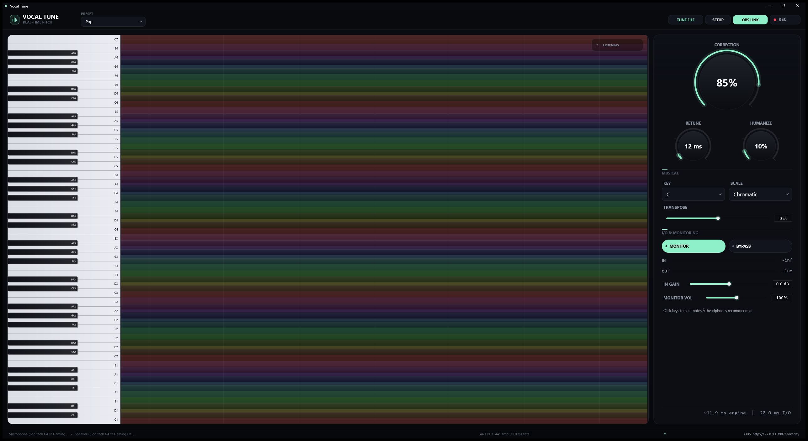

# Vocal Tune



Real-time pitch correction with a live piano-roll pitch line and an OBS Browser Source overlay.

Native Windows app (JUCE 8 + WASAPI). Fully self-contained: no installer, no runtime dependencies,
settings and recordings stay next to the executable.

## Download

[Download the latest portable Windows build](https://github.com/SuperFurias/vocal-tune/releases/latest),
unzip it into a writable folder, and run **Vocal Tune.exe**. No installer or runtime is required.

## Run the portable build

1. Unzip / copy the downloaded folder somewhere writable (not inside Program Files).
2. Double-click **Vocal Tune.exe**.
3. The window appears immediately and audio opens inside the app with a loading panel. The OBS
   overlay link is already available while the audio device initializes (the first open can take a
   few seconds). Choose the mic, output, device type and buffer in **SETUP**.
4. For the lowest latency, choose **Windows Audio (Low Latency Mode)** or **Exclusive Mode** and the
   smallest stable buffer in SETUP. The choice is remembered next to the exe.
5. Use headphones. Monitoring the mic through speakers can create feedback.
6. If the input meter stays at `-inf`, check the Windows microphone privacy/level setting and lower
   **NOISE GATE** in SETUP.

Settings are stored in `settings.json` and `audio-device.xml` beside the exe. Recordings go to the
`Recordings` folder beside the exe.

## Controls

- **CORRECTION** - snap strength (0-100%). 0 is clean/bypass, 100 is full hard tune.
- **RETUNE** - glide time in milliseconds. 0 ms = instant note jumps.
- **HUMANIZE** - adds a small musical drift to the target note.
- **KEY / SCALE** - allowed target notes. The app starts with Key = **Chromatic** (every semitone,
  scale filter disabled); choose a musical key to use the Scale list.
- **TRANSPOSE** - shift the corrected voice up or down in semitones.
- **MONITOR** - hear the processed voice.
- **BYPASS** - keep the visualizer running while passing the voice through.
- **IN GAIN** - microphone input level.
- **MONITOR VOL** - master volume for the processed voice and the piano reference notes
  (0-200%; 100% is unity).
- **PIANO KEYS** - the real-layout keyboard spans C1-C7 and labels every note. White keys use their
  full key body; black keys are shorter and sit on top of the adjacent white key bands. Click or drag
  across it to hear reference notes. They follow MONITOR VOL, play even when mic monitoring is muted,
  and are not included in recordings.
- **REC** - record the processed voice as a 24-bit mono WAV in `Recordings\`.
- **TUNE FILE** - open the audio workbench: choose or drop a WAV/AIFF/FLAC/OGG/MP3, inspect its
  waveform, use the transport under it to **PLAY/PAUSE** and switch between **ORIGINAL** and **TUNED**,
  choose a preset and adjust the tuning, then render a 24-bit WAV.
- Presets: Natural (default) / Pop / Tight / Hard Tune / Clean; moving the pitch controls selects Custom.
- Shortcuts: `M` monitor, `B` bypass, `R` record, `F1` audio setup, `F2` OBS link, `F3` tune file.

The interface scales with the window size, so maximizing gives larger labels, dials and keyboard keys.
The layout compacts at small heights, so it stays readable down to roughly 980 x 780.

## Tune a file

1. Click **TUNE FILE** to open the audio workbench.
2. Choose a source file or drop it onto the waveform area. The panel shows the waveform, duration,
   sample rate, channel layout and bit depth. Click **CHANGE AUDIO** to swap files.
3. Use the transport directly under the waveform: **-10s**, **PLAY / PAUSE**, **+10s**,
   **ORIGINAL / TUNED**, a preview progress bar and a time readout. Click or drag the waveform or the
   progress bar to seek anywhere in the file; the A/B switch is crossfaded and a playhead moves over
   the waveform. The preview output is prepared as soon as the file loads, so pressing PLAY starts
   promptly.
4. Adjust **PRESET, KEY, SCALE, TRANSPOSE, CORRECTION, RETUNE, HUMANIZE, TUNING A4 and INPUT GAIN**.
   PRESET loads the same Natural, Pop, Tight, Hard Tune and Clean shapes as the live panel; changing
   correction, retune or humanize selects Custom. The preview updates while playing, and these
   settings are also used for the export. **MATCH LIVE** copies the current live-panel values into the
   workbench. These controls do not change the live engine.
5. The destination is filled in automatically as `<source>-tuned.wav`; use **BROWSE** to choose another
   WAV destination.
6. Click **EXPORT WAV**. In-panel progress appears for long files, and the same button switches to
   **CANCEL** while rendering. Playback pauses when an export starts.
7. MONITOR VOL and BYPASS do not affect the exported file. Mono sources stay mono, stereo sources stay
   stereo, the original sample rate is preserved, and the duration is kept intact (engine latency is
   trimmed automatically).
8. Preview audio uses the default Windows output device. If the live engine is set to Exclusive Mode,
   use a shared-mode output for preview or close the exclusive device owner.

## OBS overlay

1. Click **OBS LINK** in the app.
2. Click **COPY LINK** (or copy the URL from the dialog).
3. In OBS: **Sources > + > Browser**, paste the URL.
4. Set Width/Height to `1920` x `1080`, keep the background transparent, and disable
   "Shutdown source when not visible" if you want the overlay to keep updating.
5. Optional: add a caption in the app before copying the link, or open **DEMO PREVIEW** to see the
   animated overlay without a microphone.

The overlay stays live only while **Vocal Tune.exe** is running. The server listens on
`127.0.0.1` only and does not open a firewall port to the network. If port 39871 is busy, the app
automatically uses the next free port; always copy the URL shown in the OBS dialog.

Overlay URL parameters (append with `&`):

| Parameter | Default | Meaning |
|---|---|---|
| `keyboard` | `1` | show the piano keys |
| `grid` | `1` | show the time grid |
| `target` | `1` | show the faint target-note guide |
| `history` | `7` | visible seconds (2-20) |
| `opacity` | `0.9` | band opacity (0.15-1) |
| `caption` | - | caption burned into the overlay |
| `color` | `white` | line colour (hex without `#`) |
| `accent` | `#8ef0c8` | head / target accent colour |
| `glow` | `1` | glow intensity (0-2) |
| `demo` | `0` | `1` draws a synthetic demo voice (useful for testing OBS) |
| `note` | `0` | `1` shows a note-name pill at the line head |

Example:
`http://127.0.0.1:39871/overlay?keyboard=1&grid=1&target=1&history=7&caption=This%20is%20my%20voice.`

## Latency

The engine reports the device buffer and total latency in the bottom bar and in SETUP. At 441 samples
/ 44.1 kHz the total including the pitch engine is about 32 ms. Pick the smallest stable buffer in
SETUP for lower latency.

For the absolute lowest latency, choose **Windows Audio (Exclusive Mode)** as the device type in
SETUP. Exclusive mode can prevent other applications (including OBS desktop audio capture) from using
that device. **Windows Audio (Low Latency Mode)** is the recommended shared-mode choice. The selected
device setup is saved in `audio-device.xml` beside the exe.

## Build from source

Repository: <https://github.com/SuperFurias/vocal-tune>

Requirements: Windows 10/11, Visual Studio 2022 with the C++ workload, CMake 3.22+, Git.
JUCE 8.0.15 is fetched automatically by CMake.

```powershell
git clone https://github.com/SuperFurias/vocal-tune.git
cd vocal-tune
cmake -S . -B build -G "Visual Studio 17 2022" -A x64
cmake --build build --config Release
```

Executable: `build\VocalTune_artefacts\Release\Vocal Tune.exe`

Tests:

```powershell
cmake --build build --config Release --target VocalTuneTests OfflineRenderTests PitchViewTests AudioFilePanelTests
.\build\Release\VocalTuneTests.exe
.\build\Release\OfflineRenderTests.exe
.\build\Release\PitchViewTests.exe
.\build\Release\AudioFilePanelTests.exe
```

`OfflineRenderTests` verifies file rendering, channel/length preservation, pitch shift and MP3 support.
`PitchViewTests` verifies every black and white key click target, pitch-band alignment and writes an
offscreen UI snapshot to `Artifacts\pitchview-offscreen.png`.
`AudioFilePanelTests` loads a WAV in the workbench, applies a preset, checks the compact control
layout for overlap, exports the file, and writes an offscreen panel snapshot to
`Artifacts\audio-file-panel-final.png`.

## DSP notes

- FFT-accelerated YIN pitch detection (60-1100 Hz).
- Dual-tap pitch-synchronous resampling shifter; crossfades are aligned to whole pitch periods and
  the delay window is fixed, so there is no drift. Small corrections keep formants natural.
- Scale quantizer with nearest-in-scale snapping, retune smoothing, humanize drift, key and transpose.
- Noise gate, 24-bit WAV recording, soft limiter, low-latency WASAPI modes.

## Third-party

Built with [JUCE](https://juce.com) 8.0.15. JUCE is available under the GNU Affero General Public
License v3 (AGPLv3) or a commercial licence. No other third-party libraries are used.

This is an independent tool and is not affiliated with Antares Audio Technologies.

## License

Copyright (c) 2026 Vocal Tune contributors.

This project is licensed under the GNU Affero General Public License v3.0 (AGPL-3.0). See
[`LICENSE`](LICENSE) for the full text. The AGPL also satisfies the open-source JUCE licence
requirement; if you hold a commercial JUCE licence, you may choose different terms for your own
distribution.
